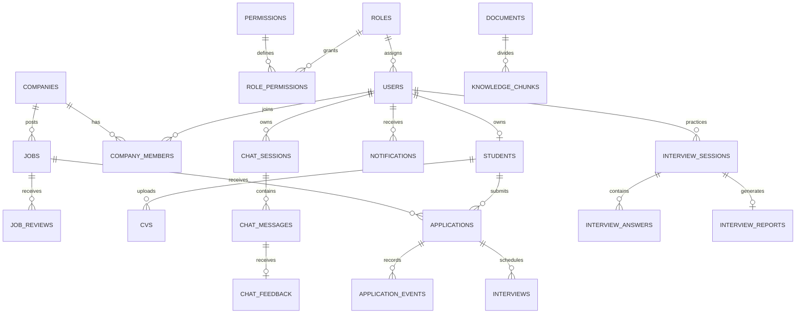

# Quan hệ dữ liệu

`vector_sync_queue` giữ tác vụ của jobs, cvs và knowledge. `ai_usage_logs` giữ mô hình, token, độ trễ và chi phí ước tính khi có cấu hình giá. `question_bank` giữ câu hỏi và rubric nguồn. Kỹ năng chuẩn nằm trong `skills`. Quyền sở hữu lấy từ quan hệ người dùng, hồ sơ sinh viên và thành viên doanh nghiệp.
